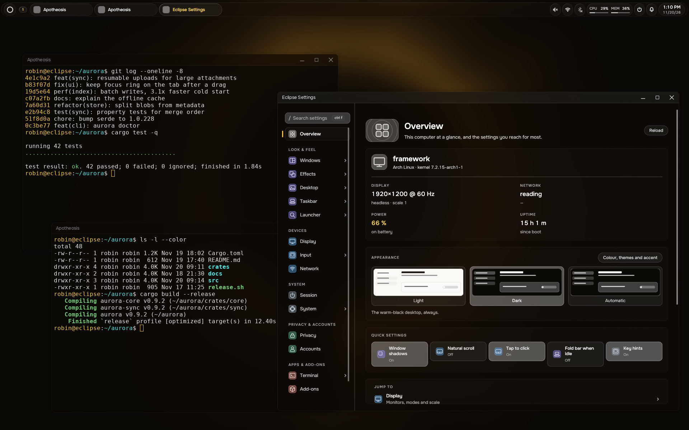
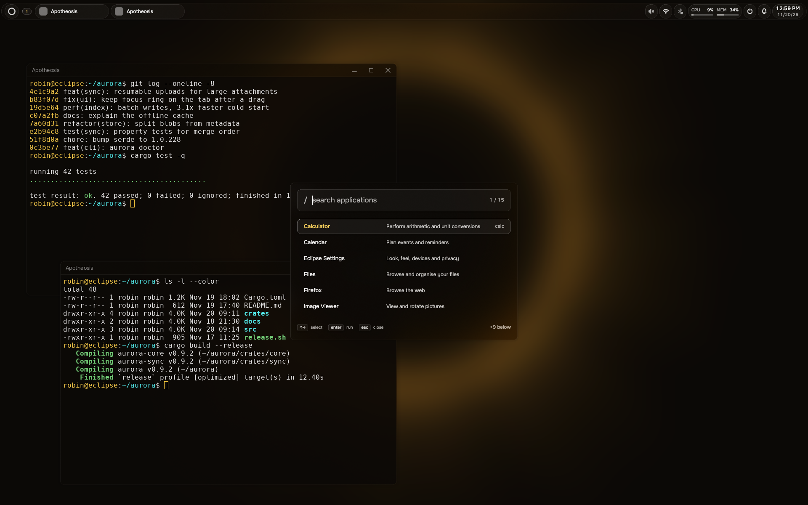
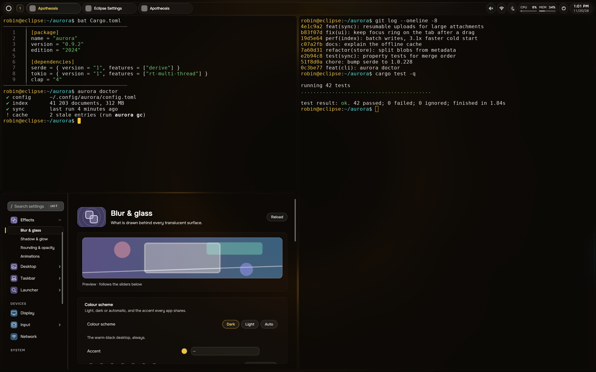
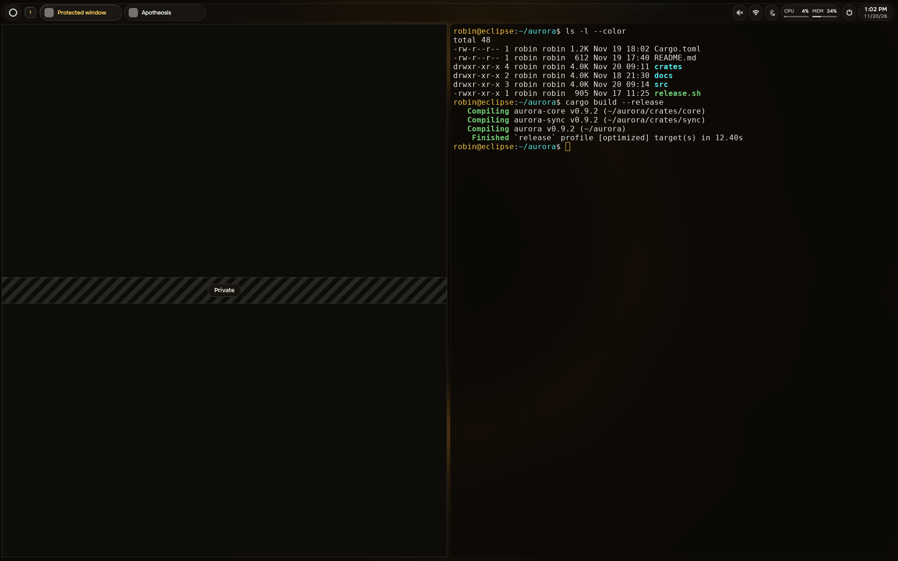
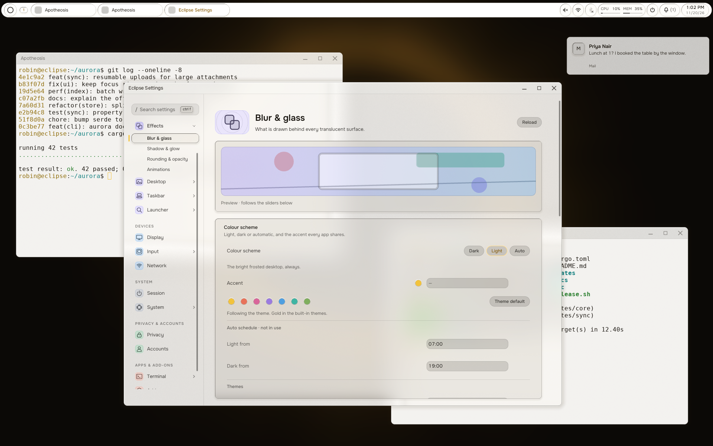
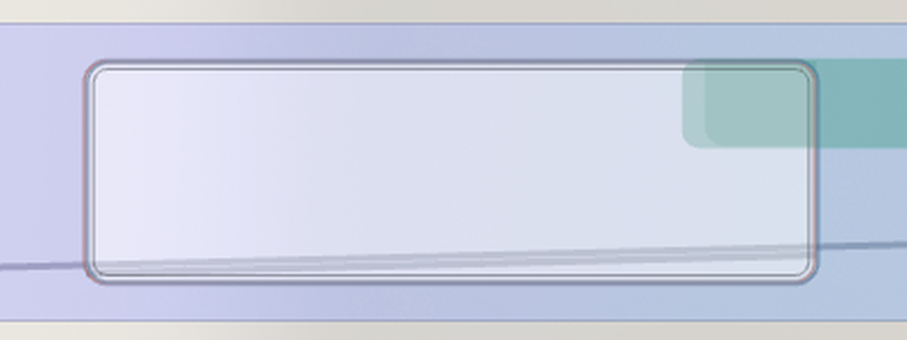
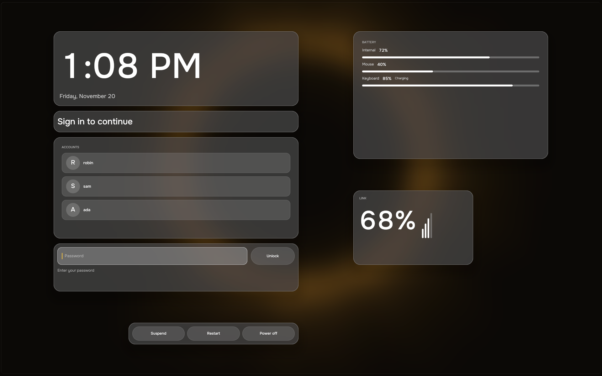
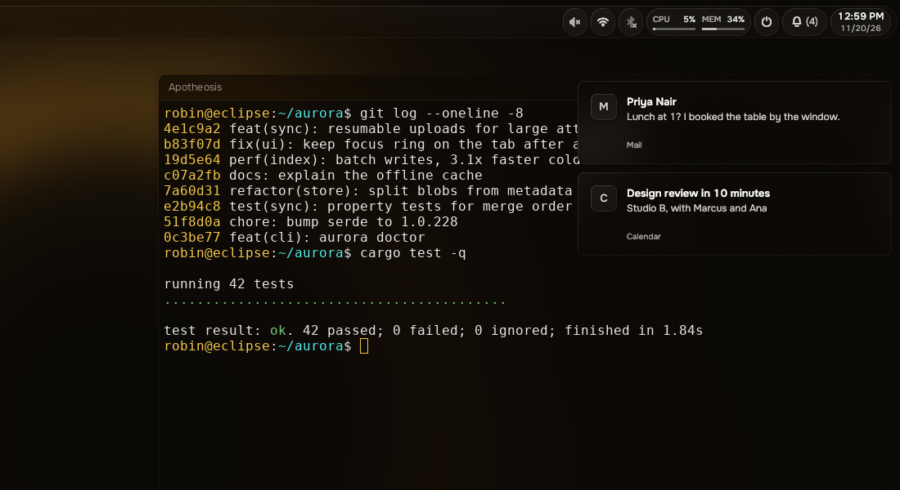

[English](README.md) | **Español**

<p align="center">
  
</p>

<p align="center">
  
  
</p>


> Hola, y bienvenido, a EclipseOS.  
> Mi regalo para el mundo, mi labor de amor.  
> He estado trabajando en EclipseOS desde el 28/8/2026, casi sin parar.  
> El objetivo de EclipseOS no es el reconocimiento, ni superar a los demás.  
> Es simplemente mi intento de hacer algo que a otras personas les guste.  
> Realmente espero que lo disfrutes.
> - Chase Brown

<table>
  <tr>
    <td rowspan="2" width="60%"></td>
    <td width="40%"></td>
  </tr>
  <tr>
    <td></td>
  </tr>
</table>

<p align="center">
  <br>
  <sub>Lo que ve una pantalla compartida: el administrador de contraseñas queda cubierto en el origen.</sub>
</p>

### Última versión: ASCENSIONISM

El vidrio es ahora un solo material en todas partes, en oscuro y en claro: el lanzador, Ajustes, la pantalla de bloqueo, la de inicio de sesión, las notificaciones y las confirmaciones de seguridad del propio compositor. Una sola tipografía, Onest, recorre todo, desde el logotipo hasta las barras de título. Ajustes tiene una página de Resumen, navegación real y vistas previas en vivo, y el modo claro es blanco papel. Las notas completas están en el [CHANGELOG](CHANGELOG.md) (en inglés).

<table>
  <tr>
    <td width="50%"></td>
    <td width="50%"></td>
  </tr>
  <tr>
    <td></td>
    <td></td>
  </tr>
</table>

## Qué es EclipseOS

EclipseOS es un escritorio Linux construido sobre Arch. Su compositor, su escritorio, su administrador de archivos y su instalador están diseñados en conjunto y se ven y se comportan como una sola cosa. En el centro está **Abyss**, un compositor Wayland escrito en Rust. Todo lo que ves a su alrededor también está escrito en Rust: la barra de tareas, el lanzador, las notificaciones, Settings, el administrador de archivos Fog, la pantalla de bloqueo y el instalador.

Se ve como vidrio líquido: oscuro por defecto con un acento dorado, con capas translúcidas y desenfocadas, esquinas redondeadas, profundidad suave y movimiento fluido. Además mantiene privado lo que hay en tu pantalla cuando no quieres que se vea.

**Filosofía**

- **Un SO completo, no un tema.** El compositor, el escritorio, el administrador de archivos y el instalador están diseñados en conjunto, así que el sistema se siente como una sola cosa desde la instalación hasta el uso diario.
- **Vidrio que se puede leer.** Oscuro por defecto con un acento dorado. Un vidrio que se adapta a lo que haya detrás, de modo que el texto sigue siendo legible con cualquier fondo de pantalla.
- **Trabaja a tu manera.** Un escritorio clásico, mosaico o una mezcla de ambos. Teclado, mouse, pantalla táctil y tableta son ciudadanos de primera clase.
- **Privado por defecto.** Nada obtiene acceso ambiental, y toda operación sensible falla de forma cerrada. Lo que hay en tu pantalla sigue siendo tuyo cuando la compartes. Las pulsaciones de teclas, el portapapeles y el IME nunca se registran.
- **Se mantiene en pie.** Una mala actualización o una función que falla nunca te cuesta la sesión.

## Qué lo hace diferente

Otros escritorios tienen una parte de esto. EclipseOS se diseñó en torno a esto desde el principio.

- **Vidrio adaptativo.** Cada superficie de vidrio (la barra de tareas, los paneles, el vidrio de las ventanas, las barras de título) mide el fondo que tiene detrás en la GPU, en cada fotograma, y ajusta su propio tinte para que el texto que lleva siga siendo legible. Se oscurece sobre una foto brillante y se aclara sobre una oscura. Nada se lee de vuelta a la CPU, y ninguna aplicación ve tu pantalla para lograrlo.
- **Vidrio líquido real.** Más allá del desenfoque, hay tres estilos de vidrio: `blur`, `frost` y `glass`, que añade refracción, dispersión cromática, un bisel y luz de borde. Los dibuja el compositor, así que son consistentes en todas partes y no le cuestan nada a las aplicaciones.
- **Vidrio para aplicaciones que no lo admiten.** Algunas aplicaciones, Firefox entre ellas, siempre dibujan ventanas opacas. El *vidrio por clave* (keyed glass) permite que el compositor convierta colores elegidos del marco de una aplicación en vidrio translúcido, de modo que se integre con el resto del escritorio. El complemento de Firefox lo usa. Un complemento para Steam que adapta la interfaz de Steam para que combine está en desarrollo.
- **Un sistema de animación en todo el compositor.** Abrir, cerrar y mover ventanas, cambiar de espacio de trabajo, minimizar, capas, foco, chips de la barra de tareas y avisos emergentes son animados por el compositor. Elige un preajuste (`off`, `subtle`, `smooth`, `lively`), ajusta las curvas por evento o incorpora shaders de transición GLSL desde un complemento. Una ventana que se cierra deja un fantasma que se desvanece después de que la aplicación ya no está. La opción de reducir movimiento se respeta en todas partes.
- **Mosaico Radiant.** Las divisiones son ponderadas y pueden contener cualquier cantidad de ventanas, no solo pares. Arrastra una ventana y un fantasma muestra exactamente dónde aterrizará, con algo de histéresis para que no parpadee entre zonas. Cambiar de disposición y volver no pierde nada.
- **Mueve ventanas desde cualquier lugar.** Mantén presionado Super y arrastra en el panel táctil, o Alt-arrastra en cualquier parte de una ventana, para moverla sin buscar una barra de título.
- **Una barra de tareas con física.** Los chips se deslizan sobre resortes críticamente amortiguados que pueden interrumpirse en pleno movimiento. Fija aplicaciones, reorganiza widgets con una barra de arrastre o escribe tus propios widgets que ejecuten un comando o transmitan su salida. ¿Prefieres otra barra? `components.bar` la reemplaza por Waybar, Quickshell o ninguna.
- **Capturas que se ven como tu pantalla.** La captura integrada congela el fotograma mientras eliges una región y se renderiza a través del pipeline propio del compositor, así que las capturas conservan el desenfoque, el vidrio, el redondeo y las sombras. Se redactan con las mismas reglas que una pantalla compartida.
- **Complementos, no forks.** Los extras son complementos: un manifiesto más hooks del host que están desactivados hasta que los actives. El complemento de vidrio para Firefox es uno. El complemento de Steam está en desarrollo, y Oracle Eyes (que da vida al ojo de eclipse de la barra de tareas) es opcional y no se incluye con el SO.
- **Configuración que se edita como un documento.** Settings escribe los cambios en tu archivo KDL en el mismo lugar, byte por byte. Tus comentarios, el orden y el formato sobreviven a cada cambio hecho desde la GUI, y [CONFIG.md](docs/CONFIG.md) se genera a partir del mismo esquema, así que la documentación no puede desfasarse.
- **Laptops con GPU híbrida resueltas como corresponde.** Cada GPU puede manejar sus propias pantallas, con una ruta de copia segura por defecto y composición nativa como opción. Las pantallas se reconocen por su EDID, y las disposiciones se recuerdan por cada conjunto de monitores.
- **Privacidad integrada en el compositor.** Las pantallas compartidas se redactan en el origen, y el indicador de captura lo dibuja el compositor para que ninguna aplicación pueda ocultarlo. Más [abajo](#privado-por-defecto).

## El escritorio

- **Escritorio o mosaico, a tu elección.** En modo `de` tienes un escritorio apilado con barras de título, maximizar, Quick Tile, ajuste, iconos de escritorio, Alt-Tab, una vista general y esquinas activas. El modo `wm` organiza en mosaico con las disposiciones Radiant, dwindle y master. `hybrid` queda entre los dos. Puedes cambiar en cualquier momento, y tus ventanas se conservan.
- **Oscuro y claro, derivados.** Los temas se derivan de unos pocos colores semilla, y el contraste se verifica automáticamente. Oscuro y claro vienen integrados, y el escritorio puede seguir la hora del día.
- **Un escritorio completo, no un surtido de piezas.** La barra de tareas, el lanzador con búsqueda, los avisos de notificación y su historial, el centro de control, Settings, el administrador de archivos Fog y el bloqueador de pantalla comparten un solo sistema de diseño.
- **Diálogos de archivos que combinan.** Las aplicaciones que piden un archivo al portal del escritorio obtienen el selector de Fog.
- **Ajustes que no puedes romper.** Todo vive en un solo archivo KDL que se recarga en caliente. Una edición incorrecta se reporta y nunca derriba la sesión. La aplicación Settings edita ese mismo archivo en el lugar.
- **Se adapta a las aplicaciones que ya usas.** Los complementos opcionales le dan a Firefox y a Steam el mismo vidrio. Se manejan los monitores múltiples y las laptops con GPU híbrida, y también los paneles táctiles, las pantallas táctiles y las tabletas.

## Privado por defecto

- **Compartir pantalla oculta lo que debe ocultar.** El compositor redacta en el origen. Los administradores de contraseñas y las ventanas marcadas como secretas se cubren con cinta policial en las pantallas compartidas, las grabaciones y las capturas. Los avisos de notificación se redactan, se retienen o se envían directo al historial. Las miniaturas de Alt-Tab y de la vista general nunca salen del compositor, y una ventana que contiene algo sensible nunca se envía directo al scanout, de modo que ningún fotograma se escapa de la redacción.
- **Siempre sabes cuándo te están capturando.** Mientras algo captura la pantalla, el ojo de eclipse de la barra de tareas muestra una pupila roja en movimiento. Lo dibuja el compositor, así que una aplicación no puede ocultarlo ni falsificarlo.
- **Las contraseñas solo van adonde corresponde.** La pantalla de inicio de sesión se ejecuta dentro de Abyss en un modo kiosco restringido. Las solicitudes de contraseña de administrador (polkit) las dibuja el compositor y se envían directo al ayudante root, de modo que el agente del lado del escritorio nunca ve tu contraseña.
- **Solo las aplicaciones aprobadas pueden capturar.** La captura de pantalla, los métodos de entrada, los punteros virtuales y el administrador del portapapeles admiten únicamente los programas que listes, por su ruta completa. A todos los demás se les rechaza.
- **Una pantalla de bloqueo de verdad.** `ec-lock` mantiene la sesión hasta que la desbloquees. Si falla, se vuelve a lanzar y la sesión sigue bloqueada.
- **Avisos que ninguna aplicación puede falsificar.** Las confirmaciones las dibuja el compositor sobre todas las ventanas, nunca un cliente.

## Hecho para mantenerse en pie

- **Actualizaciones a las que se puede volver.** Se conserva la compilación anterior de Abyss. Si una nueva falla al iniciar, la sesión vuelve a la anterior, y "Abyss (previous)" aparece en la pantalla de inicio de sesión.
- **Una función rota no derriba el escritorio.** Una falla en una función opcional desactiva esa función durante la sesión, y sigues trabajando.
- **Una compuerta en cada cambio.** Cada pull request ejecuta `rustfmt`, `clippy -D warnings`, la suite de pruebas completa, `cargo-deny` y la suite de conformidad de Wayland (WLCS), con un toolchain fijado.
- **Primero la especificación.** Tres volúmenes de especificación y un conjunto de [ADRs](docs/decisions) gobiernan el código. Cuando el código y la especificación discrepan, se trata como un error. Los cambios en la ruta crítica para la seguridad reciben una revisión línea por línea.

## Agentes (en desarrollo)

Los agentes de IA están planeados como invitados en tu escritorio, no como sus dueños. Ese trabajo **no está terminado**, y el foco ahora es un SO bueno y completo. Los cimientos ya existen en el árbol:

- Los agentes obtienen sus propios seats de entrada, así que nunca te roban el foco.
- Cada acción pasa por una verificación de política que falla de forma cerrada.
- Las decisiones van a un registro de auditoría encadenado por hash que puedes verificar con `ec-audit`.

La pila de agentes se distribuye por separado, como el paquete opcional `eclipseos-agents`, y nada más en el sistema depende de ella. Es experimental hasta que ese trabajo esté completo.

## Estado

**0.2.2, temprano.** El autor lo usa como su escritorio de todos los días, pero espera asperezas. [STATUS.md](docs/STATUS.md) registra lo que está construido y verificado, y [KNOWNBUGS.md](docs/KNOWNBUGS.md) lista lo que aún no funciona.

## Instalación

**Necesitarás:** una PC UEFI de 64 bits, una memoria USB (la ISO pesa unos pocos GB) y una conexión a internet durante la instalación. Desactiva Secure Boot; todavía no es compatible. El instalador borra el disco que elijas, así que haz una copia de seguridad antes.

1. **Obtén la ISO.** Todavía no se publican ISOs precompiladas. Construye una con [D-03](docs/design/D-03-installation-media.md) y [BUILDING.md](docs/BUILDING.md). Cuando se publiquen, estarán en la [página de Releases](https://github.com/chasebrowndev/EclipseOS/releases) como `eclipseos-YYYY.MM.DD-x86_64.iso`, con un `.sig` y un sha256 para verificar (`sha256sum -c eclipseos-*.iso.sha256`).
2. **Escríbela en una memoria USB.** Reemplaza `/dev/sdX` por tu memoria (verifica con `lsblk`). Todo lo que haya en ella se borra:
   ```
   sudo dd if=eclipseos-*.iso of=/dev/sdX bs=4M status=progress oflag=sync
   ```
   En Windows o macOS, usa [balenaEtcher](https://etcher.balena.io/) o Rufus (modo DD).
3. **Arranca desde ella.** Reinicia, abre el menú de arranque de tu firmware (normalmente F12, F10, F2 o Esc) y elige la memoria USB.
4. **Sigue el instalador.** Es gráfico. Elige un perfil (Minimal, Standard, Full o Agentic) y te guía en el resto.

Una vez instalado, las actualizaciones vienen del repositorio de paquetes firmado de EclipseOS con `pacman -Syu`.

## Más información

| | |
|---|---|
| [Compositor Abyss](abyss/README.es.md) | el gestor de ventanas en el corazón de EclipseOS |
| [CONFIG.md](docs/CONFIG.md) | cada ajuste, lo que hace y su valor por defecto |
| [STYLE.md](docs/STYLE.md) | el lenguaje visual |
| [ARCHITECTURE.md](docs/ARCHITECTURE.md) | cómo encajan las piezas |
| [CHANGELOG.md](CHANGELOG.md) | notas de cada versión, la más nueva primero (en inglés) |
| [STATUS.md](docs/STATUS.md) | lo que está construido y verificado |
| [CONTRIBUTING.md](CONTRIBUTING.md) | cómo contribuir y el CLA |
| [CODE_OF_CONDUCT.md](CODE_OF_CONDUCT.md) | cómo nos tratamos |
| [SECURITY.md](SECURITY.md) | el modelo de seguridad y cómo reportar una vulnerabilidad |

## Licencia

El código del sistema es **AGPL-3.0-only** ([LICENSE](LICENSE)). Las definiciones de protocolos y los SDK de agentes son **Apache-2.0** ([LICENSE-APACHE](LICENSE-APACHE)). El nombre y el logotipo no están licenciados por la AGPL: [TRADEMARK.md](TRADEMARK.md).
