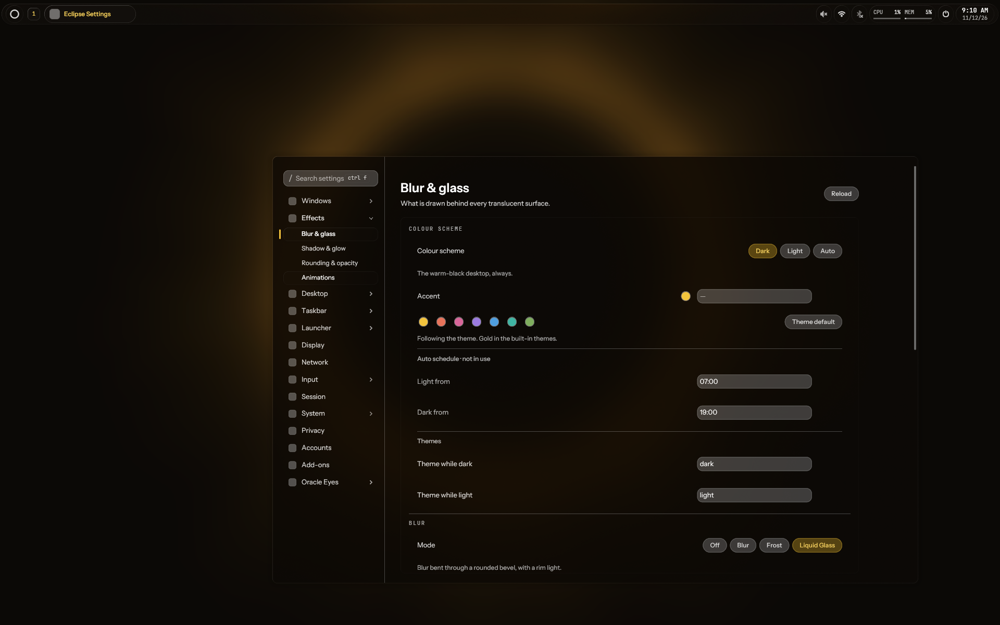
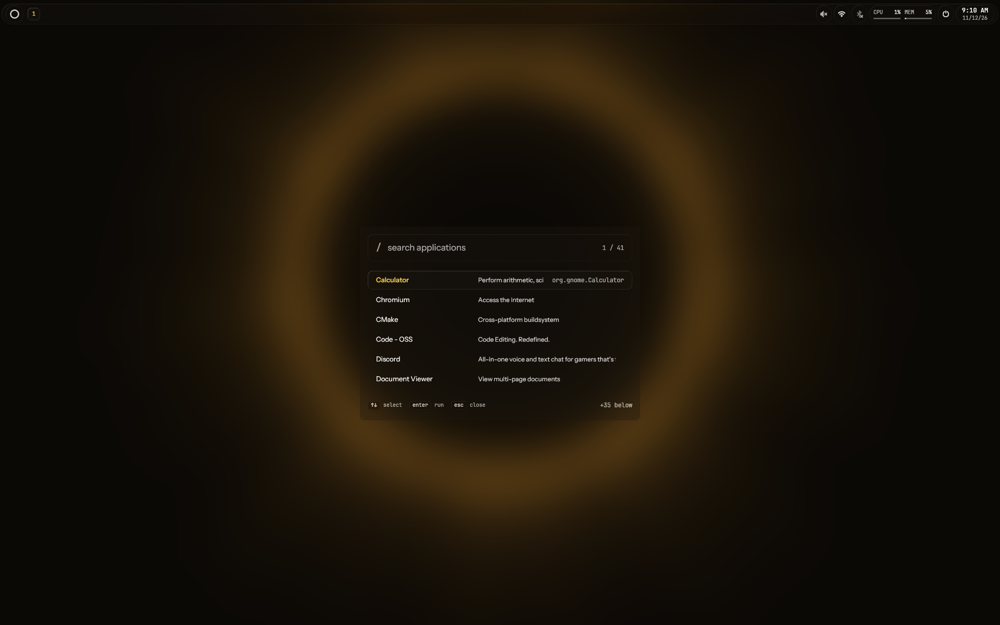
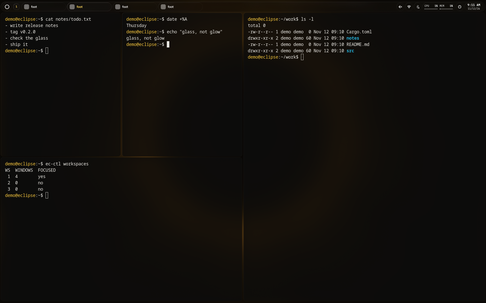
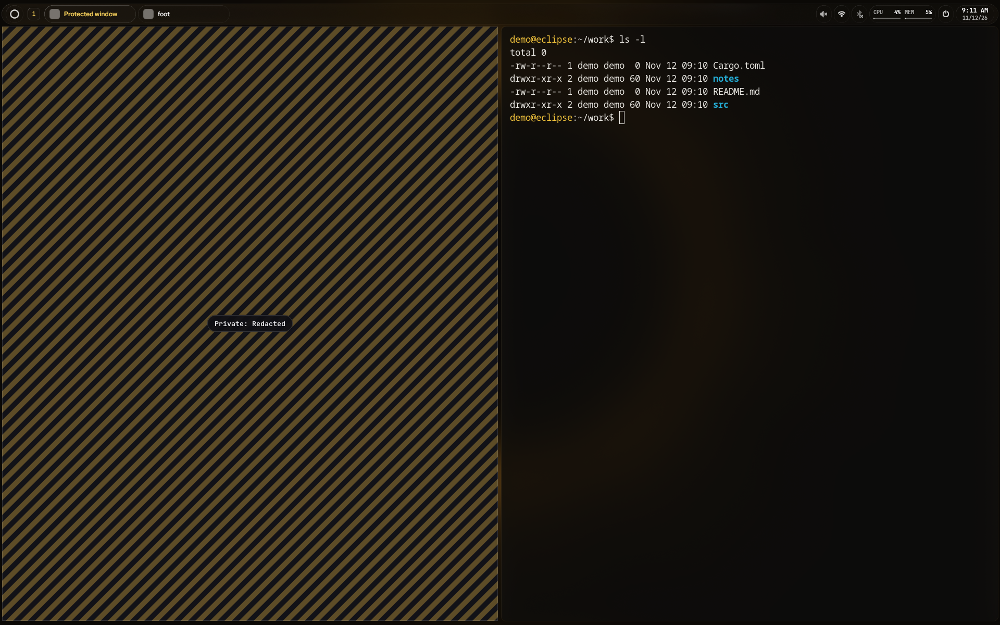

<p align="center">
  
</p>

> Hello, and welcome, to EclipseOS.  
> My gift to the world, my labor of love.  
> I have been working on EclipseOS since 8/28/2026, almost non-stop.  
> The goal of EclipseOS is not recognition, nor is it a quest to surpass others.  
> It is merely my attempt at making something other humans will like.  
> I truly, truly hope you enjoy.
> - Chase Brown

<table>
  <tr>
    <td rowspan="2" width="60%"></td>
    <td width="40%"></td>
  </tr>
  <tr>
    <td></td>
  </tr>
</table>

<p align="center">
  <br>
  <sub>What a screen share sees: the password manager is covered at the source.</sub>
</p>

## What is EclipseOS

EclipseOS is a Linux desktop built on Arch. Its compositor, desktop, file manager and installer are designed together and look and behave as one thing. At the centre is **Abyss**, a Wayland compositor written in Rust. Everything you see around it is written in Rust too: the taskbar, launcher, notifications, Settings, the Fog file manager, the lock screen and the installer.

It looks like liquid glass: dark by default with a gold accent, with translucent blurred layers, rounded corners, soft depth and fluid motion. It also keeps what is on your screen private when you don't want it seen.

**Philosophy**

- **A whole OS, not a theme.** The compositor, desktop, file manager and installer are designed together, so the system feels like one thing from install to everyday use.
- **Glass that you can read.** Dark by default with a gold accent. Glass that adapts to whatever is behind it, so text stays readable on any wallpaper.
- **Work your way.** A classic desktop, tiling, or a mix of both. Keyboard, mouse, touch and tablet are all first-class.
- **Private by default.** Nothing gets ambient access, and every sensitive operation fails closed. What's on your screen stays yours when you share it. Keystrokes, clipboard and IME are never logged.
- **It stays up.** A bad update or a crashing feature never costs you your session.

## What's different

Other desktops have some of this. EclipseOS was designed around it from the start.

- **Adaptive glass.** Every glass surface (the taskbar, panes, window glass, titlebars) measures the backdrop behind it on the GPU, every frame, and shifts its own tint to keep the text on it readable. It darkens over a bright photo and lifts over a dark one. Nothing is read back to the CPU, and no app ever sees your screen to make that happen.
- **Real liquid glass.** Beyond blur, there are three glass styles: `blur`, `frost`, and `glass`, which adds refraction, chromatic dispersion, a bevel and rim light. They're drawn by the compositor, so they're consistent everywhere and cost apps nothing.
- **Glass for apps that don't support it.** Some apps, Firefox among them, always draw opaque windows. *Keyed glass* lets the compositor turn chosen colours in an app's frame into translucent glass, so it blends with the rest of the desktop. The Firefox add-on uses it. A Steam add-on that themes Steam's UI to match is a work in progress.
- **A compositor-wide animation system.** Opening, closing and moving windows, switching workspaces, minimising, layers, focus, taskbar chips and toasts are all animated by the compositor. Pick a preset (`off`, `subtle`, `smooth`, `lively`), tune curves per event, or drop in GLSL transition shaders from an add-on. A closing window leaves a ghost that fades out after the app is already gone. Reduce-motion is respected everywhere.
- **Radiant tiling.** Splits are weighted and can hold any number of windows, not just pairs. Drag a window and a ghost shows exactly where it will land, with a little hysteresis so it doesn't flicker between zones. Switching layouts and back loses nothing.
- **Move windows from anywhere.** Hold Super and drag on the touchpad, or Alt-drag anywhere in a window, to move it without hunting for a titlebar.
- **A taskbar with physics.** Chips slide on critically damped springs that can be interrupted mid-motion. Pin apps, rearrange widgets on a drag bar, or write your own widgets that run a command or stream its output. Prefer another bar? `components.bar` swaps in Waybar, Quickshell or none.
- **Screenshots that look like your screen.** The built-in screenshot freezes the frame while you pick a region and renders through the compositor's own pipeline, so shots keep the blur, glass, rounding and shadows. They are redacted by the same rules as a screen share.
- **Add-ons, not forks.** Extras are add-ons: a manifest plus host hooks that are off until you turn them on. The Firefox glass add-on is one. The Steam add-on is a work in progress, and Oracle Eyes (which brings the taskbar's eclipse eye to life) is optional and not shipped with the OS.
- **Config that edits like a document.** Settings writes changes into your KDL file in place, byte for byte. Your comments, ordering and formatting survive every change made from the GUI, and [CONFIG.md](docs/CONFIG.md) is generated from the same schema, so the docs can't drift.
- **Hybrid-GPU laptops handled properly.** Each GPU can drive its own screens, with a safe copy path by default and native compositing as an option. Displays are recognised by their EDID, and layouts are remembered per set of monitors.
- **Privacy built into the compositor.** Screen shares are redacted at the source, and the capture indicator is drawn by the compositor so no app can hide it. More [below](#private-by-default).

## The desktop

- **Desktop or tiling, your choice.** In `de` mode you get a stacking desktop with titlebars, maximize, Quick Tile, snapping, desktop icons, Alt-Tab, an overview and hot corners. `wm` mode tiles with Radiant, dwindle and master layouts. `hybrid` sits between the two. You can switch at any time, and your windows are kept.
- **Dark and light, derived.** Themes are derived from a few seed colours, and contrast is checked automatically. Dark and light are both built in, and the desktop can follow the time of day.
- **A complete desktop, not a parts bin.** The taskbar, launcher with search, notification toasts and history, control centre, Settings, Fog file manager and screen locker share one design system.
- **File dialogs that match.** Apps that ask the desktop portal for a file get Fog's picker.
- **Settings you can't break.** Everything lives in one KDL file that hot-reloads. A bad edit is reported and never takes the session down. The Settings app edits the same file in place.
- **Fits the apps you already use.** Optional add-ons give Firefox and Steam the same glass. Multi-monitor and hybrid-GPU laptops are handled, and so are touchpads, touchscreens and tablets.

## Private by default

- **Screen sharing hides what it should.** The compositor redacts at the source. Password managers and marked-secret windows are covered with police tape in shares, recordings and screenshots. Notification toasts are redacted, held back or sent straight to history. Alt-Tab and overview thumbnails never leave the compositor, and a window holding something sensitive is never scanned out directly, so no frame slips past redaction.
- **You always know when you're being captured.** While anything captures the screen, the eclipse eye on the taskbar shows a moving red pupil. The compositor draws it, so an app can't hide it or fake it.
- **Passwords only go where they belong.** The login screen runs inside Abyss in a locked-down kiosk mode. Admin (polkit) password prompts are drawn by the compositor and sent straight to the root helper, so the desktop-side agent never sees your password.
- **Only approved apps can capture.** Screen capture, input methods, virtual pointers and the clipboard manager admit only the programs you list, by their full path. Everyone else is refused.
- **A real lock screen.** `ec-lock` holds the session until you unlock it. If it crashes, it is relaunched and the session stays locked.
- **Prompts no app can fake.** Confirmations are drawn by the compositor above every window, never by a client.

## Built to stay up

- **Updates you can walk back.** The previous Abyss build is kept. If a new one crashes at startup, the session falls back to the old one, and "Abyss (previous)" is on the login screen.
- **One broken feature doesn't take the desktop down.** A crash in an optional feature turns that feature off for the session, and you keep working.
- **A gate on every change.** Every pull request runs `rustfmt`, `clippy -D warnings`, the full test suite, `cargo-deny` and the Wayland conformance suite (WLCS), with a pinned toolchain.
- **Spec first.** Two spec volumes and a set of [ADRs](docs/decisions) govern the code. Where code and spec disagree, that is treated as a bug. Changes to the security-critical path get a line-by-line review.

## Agents (in progress)

AI agents are planned as guests on your desktop, not owners of it. That work is **not finished**, and the focus right now is a good, well-rounded OS. The foundations already exist in the tree:

- Agents get their own input seats, so they never steal your focus.
- Every action passes a policy check that fails closed.
- Decisions go into a hash-chained audit log you can verify with `ec-audit`.

The agent stack ships separately, as the optional `eclipseos-agents` package, and nothing else on the system depends on it. It is experimental until that work is complete.

## Status

**0.2.1, early.** The author uses it as their everyday desktop, but expect rough edges. [STATUS.md](docs/STATUS.md) records what is built and verified, and [KNOWNBUGS.md](docs/KNOWNBUGS.md) lists what isn't working yet.

## Install

**You will need:** a 64-bit UEFI PC, a USB stick (the ISO is a few GB), and an internet connection during install. Turn Secure Boot off; it isn't supported yet. The installer erases the disk you pick, so back up first.

1. **Get the ISO.** Prebuilt ISOs are not published yet. Build one with [D-03](docs/design/D-03-installation-media.md) and [BUILDING.md](docs/BUILDING.md). When they are published, they will be on the [Releases page](https://github.com/chasebrowndev/EclipseOS/releases) as `eclipseos-YYYY.MM.DD-x86_64.iso`, with a `.sig` and a sha256 to check (`sha256sum -c eclipseos-*.iso.sha256`).
2. **Write it to a USB stick.** Replace `/dev/sdX` with your stick (check with `lsblk`). Everything on it is erased:
   ```
   sudo dd if=eclipseos-*.iso of=/dev/sdX bs=4M status=progress oflag=sync
   ```
   On Windows or macOS, use [balenaEtcher](https://etcher.balena.io/) or Rufus (DD mode).
3. **Boot from it.** Restart, open your firmware's boot menu (usually F12, F10, F2 or Esc), and choose the USB stick.
4. **Follow the installer.** It is graphical. Pick a profile (Minimal, Standard, Full or Agentic) and it walks you through the rest.

Once installed, updates come from the signed EclipseOS package repository with `pacman -Syu`.

## Learn more

| | |
|---|---|
| [Abyss compositor](abyss/README.md) | the window manager at the heart of EclipseOS |
| [CONFIG.md](docs/CONFIG.md) | every setting, what it does and its default |
| [STYLE.md](docs/STYLE.md) | the visual language |
| [ARCHITECTURE.md](docs/ARCHITECTURE.md) | how the pieces fit together |
| [STATUS.md](docs/STATUS.md) | what is built and verified |
| [SECURITY.md](SECURITY.md) | the security model and how to report a vulnerability |

## Licence

System code is **AGPL-3.0-only** ([LICENSE](LICENSE)). Protocol definitions and the agent SDKs are **Apache-2.0** ([LICENSE-APACHE](LICENSE-APACHE)). The name and logo are not licensed by the AGPL: [TRADEMARK.md](TRADEMARK.md).
